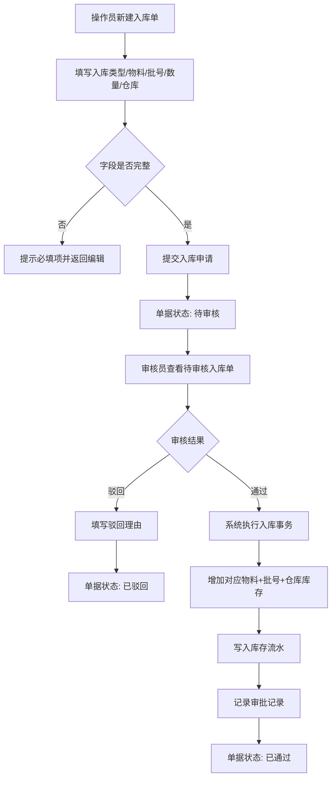
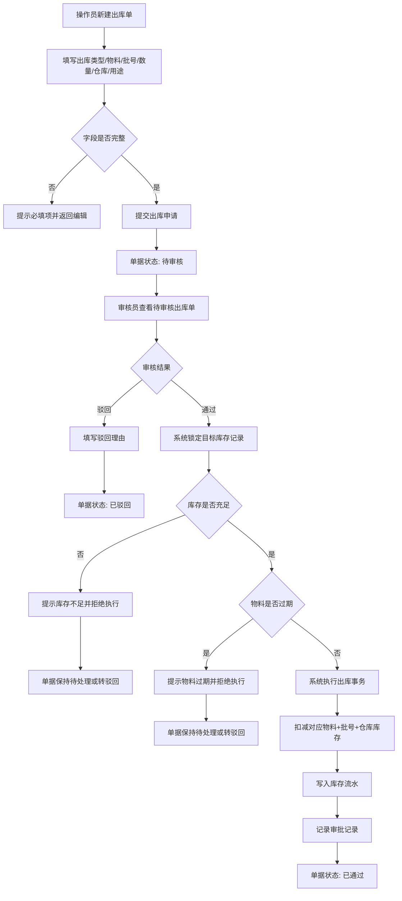
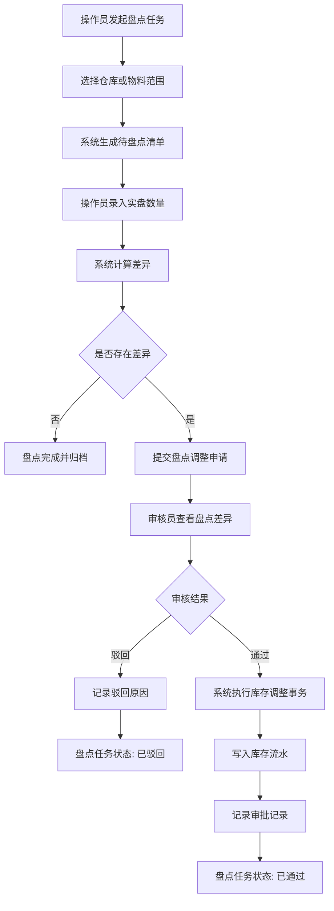
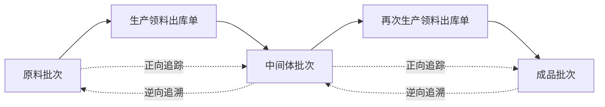

# Materia ERP 业务流程图

## 1. 入库全流程（含审批）

## 2. 出库全流程（含审批、库存校验）

## 3. 盘点流程

## 4. 批次追溯关系

## 5. 追溯数据记录原则

1. 生产领料时记录上游批次消耗关系。  
2. 生产入库时记录下游批次生成结果。  
3. 同一成品批次可关联多个原料批次。  
4. 查询追溯链时，需同时返回物料、批号、数量、来源单据和时间。  
